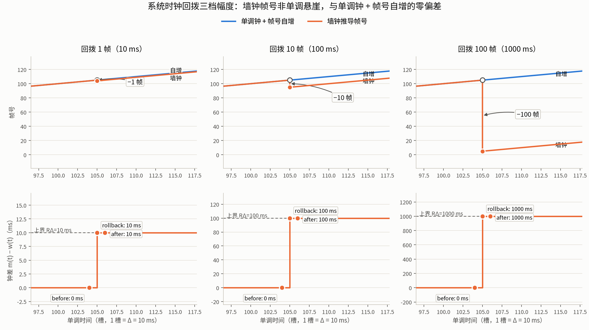

# 三档回拨：偏差与帧号变化对照

帧周期 Δ=10ms（100Hz），回拨点 rb=105，每档回拨一次。完整证明见 `docs/clock-rollback.md`。

## 对照表

| 回拨幅度 R(帧) | 回拨前 F(rb−1) | 回拨瞬间前 F(rb⁻) | 回拨瞬间后 F(rb⁺) | 回拨后 F(rb+1) | 最大回退量(帧) | 墙钟累计偏差 D_wall(帧)=ΣR | 自增累计偏差 D_fixed(帧) | <1 帧 | 追平快进(欠账/快进槽) | 钟差三点 前/拨/后(ms) | 结论 |
|---:|---:|---:|---:|---:|---:|---:|---:|:---:|---:|---:|:---|
| 1 | 104 | 105 | 104 | 105 | 1 | **1** | **0** | 是 | 1 / 1 | 0 / 10 / 10 | ✅ PASS |
| 10 | 104 | 105 | 95 | 96 | 10 | **10** | **0** | 是 | 10 / 10 | 0 / 100 / 100 | ✅ PASS |
| 100 | 104 | 105 | 5 | 6 | 100 | **100** | **0** | 是 | 100 / 100 | 0 / 1000 / 1000 | ✅ PASS |

## 各档帧号局部序列（`rb−2 … rb⁻, rb⁺, rb+1, rb+2`）

- **R=1 帧**：`103 → 104 → 105 → 104 → 105 → 106`；在同一单调时刻从 105 跳到 104，跌幅正好 1 帧。最大幅度组的“悬崖”最明显。
- **R=10 帧**：`103 → 104 → 105 → 95 → 96 → 97`；在同一单调时刻从 105 跳到 95，跌幅正好 10 帧。最大幅度组的“悬崖”最明显。
- **R=100 帧**：`103 → 104 → 105 → 5 → 6 → 7`；在同一单调时刻从 105 跳到 5，跌幅正好 100 帧。最大幅度组的“悬崖”最明显。

## 单调钟与墙钟差值曲线（三个点：回拨前 / 回拨瞬间 / 回拨后）

| R(帧) | point=before (mono,wall,diff) ms | point=rollback (mono,wall,diff) ms | point=after (mono,wall,diff) ms | 上界 |
|---:|---|---|---|---|
| 1 | (1040,1040,**0**) | (1050,1040,**10**) | (1060,1050,**10**) | 0≤diff≤10ms=RΔ |
| 10 | (1040,1040,**0**) | (1050,950,**100**) | (1060,960,**100**) | 0≤diff≤100ms=RΔ |
| 100 | (1040,1040,**0**) | (1050,50,**1000**) | (1060,60,**1000**) | 0≤diff≤1000ms=RΔ |

机器可读数据：`mono_wall_diff.csv`（三档×三点）、`mono_wall_diff_3points.csv`（100 帧档恰好三点）。

上图由 `python3 lab/plot_clock.py artifacts` 依据 CSV 绘制（同时输出 `clock_chart.svg`）。

## 上界

- 钟差：$0 \le m(t)-w(t) \le (\sum_j R_j)\Delta$；单次回拨 $\le R\Delta$（三档分别 10 / 100 / 1000 ms）。
- 两种帧号差（同相位）：$F_{fixed}-F_{wall}=S(t)=\sum_{\tau_j\le t}R_j$，故 $0\le F_{fixed}-F_{wall}\le\sum_jR_j$。
- 计入一帧内提交滞后：$|F_{fixed}-F_{wall}|<\sum_jR_j+1$。
- 修复方案自身相对单调时间的滞后：$0\le m(t)-n\Delta<\Delta$，即归一化滞后 $\in[0,1)$，**严格低于一帧**；累计回退偏差恒为 0。

真实 `api.World` 对拍（32 帧，基线 + 三档回拨共 4 组）指纹：**一致 ✅**。

总验收：**PASS**：三档修复后累计偏差均为 0（< 1 帧），两个命题与端到端对拍全部成立。
