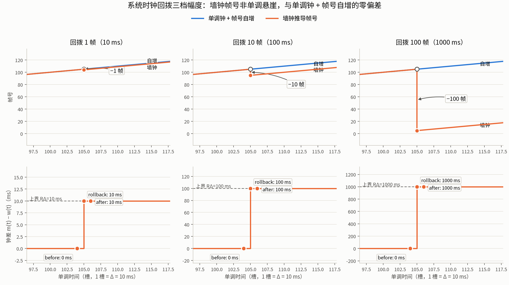

# 系统时钟回拨 → 帧号非单调：证明、修复与差值上界

本文回答题目中的三件事：

1. **证明**墙钟回拨会让“按墙钟推导的帧号”非单调，且累计偏差恰好等于各次回拨幅度之和；
2. **证明**改用单调钟截止时间 + 帧号自增后，该回拨偏差被完全消除（累计回退为 0，严格低于一帧），并给出两种时间/帧号差值的上界；
3. 给出 **1 / 10 / 100 帧三档回拨**的对照数据、每档一条时间轴，以及单调钟与墙钟差值曲线的三个点。

全部推导为整数精确运算，实现见 `internal/clock/clock.go`，测试见 `internal/clock/clock_test.go`，
产物由 `go run ./cmd/goframe clocklab` 重新生成到 `artifacts/`。

实验取固定帧周期 $\Delta=10\text{ms}$（100Hz 定步长），因此回拨 $R$ 帧就是回拨 $R\Delta=10R\text{ms}$。
换成任意 $\Delta$，下面所有以“帧”为单位的结论与上界都不变。

---

## 0. 故障模型与记号

- $m(t)$：单调钟读数（对应 `CLOCK_MONOTONIC`），实验中 $m(t)=t$，永不后退。
- $w(t)$：墙钟读数（对应 `CLOCK_REALTIME`）。设一共发生 $k$ 次回拨，第 $j$ 次幅度为整数 $R_j$ 帧、
  时刻为 $\tau_j$，则隔离“回拨”这一个变量后：

$$
w(t)=t-\Delta\cdot S(t),\qquad
S(t)=\sum_{\tau_j\le t}R_j .
$$

  即每次回拨让墙钟一次性少 $R_j\Delta$，回拨之后走速恢复为 1。单次实验 $k=1$，$S=R$。

- 墙钟帧号：

$$
F_W(t)=\left\lfloor\frac{w(t)-w_0}{\Delta}\right\rfloor .
$$

- 修复方案帧号：计数器 $n$，每提交一帧严格 $n\gets n+1$，并用单调钟截止时间
  $n$ 与 $m(t)$ 对账（见 §2）。

- 累计回退偏差定义为帧号序列上的“负增量绝对值之和”：

$$
D=\sum_i \max\bigl(0,\ F_{i-1}-F_i\bigr)\quad(\text{单位：帧}).
$$

这正是“帧号非单调造成的累计偏差”：正常推进贡献 0，每一次帧号下跳贡献其跳变量。

---

## 1. 命题一：回拨必然造成帧号非单调，且 $D_W=\sum_j R_j$

### 1.1 证明

因为 $R_j$ 是整数，回拨瞬间 $\tau_j$ 前后有

$$
w(\tau_j^+)=w(\tau_j^-)-R_j\Delta,
$$

于是整除 $\Delta$ 后

$$
F_W(\tau_j^+)
=\left\lfloor\frac{w(\tau_j^-)-R_j\Delta-w_0}{\Delta}\right\rfloor
=F_W(\tau_j^-)-R_j .
$$

所以该瞬间帧号增量为

$$
\Delta F_W=F_W(\tau_j^+)-F_W(\tau_j^-)=-R_j<0\qquad(R_j\ge1),
$$

**帧号严格非单调**，且这次下跳对累计偏差的贡献恰为 $R_j$。

其余时间墙钟以正常走速前进，相邻观测之间 $w$ 增加 $\Delta$（或其整数倍），
帧号增量为 $+1$（轮询跨多帧时为更大的正数），对 $D_W$ 的贡献 $\max(0,-\Delta F_W)=0$。
把每次回拨的贡献相加：

$$
\boxed{\,D_W=\sum_i\max(0,F_{i-1}-F_i)=\sum_{j=1}^{k}R_j\,}.
$$

单次回拨时就是 $D_W=R$：回拨 1/10/100 帧，累计偏差就分别是 1/10/100 帧。
该等式由测试 `TestCumulativeDeviationIsSumOfRollbackMagnitudes`
用 $\{1,10,100\}$ 以及多次回拨组合 $\{3,7\}$、$\{5,5,5\}$、$\{2,2,2,2\}$ 等逐组验证。

> 采样约定：回拨是同一单调时刻上的离散事件。时间轴在回拨槽 $r_b$ 存
> `rollback_pre`（回拨前读数）与 `rollback`（回拨后读数）两个点，
> 二者单调时间相同，帧号从 $r_b$ 直接变为 $r_b-R$，跌幅精确为 $R$。
> 若只按槽采样并把回拨夹在两槽之间，会被一帧的自然前进抵消 1，看到 $R-1$；
> 那是采样口径问题，不是偏差消失。

### 1.2 “仿真时间跟着退，之后一直快”

$F_W$ 在回拨后比单调进度少了 $R$ 帧的“欠账”：

$$
\text{debt}(t)=F_{\text{fixed}}(t)-F_W(t)=S(t)=R\quad(t\ge\tau).
$$

锁步/追帧调度器发现欠账后会补帧。若每个采样点在正常一帧之外多补 1 帧（2× 追帧），
还清 $R$ 帧欠账恰好需要

$$
N_{\text{fast}}=\left\lceil\frac{R}{1}\right\rceil=R\ \text{个采样点},
$$

一般多补 $c$ 帧/点时为 $\lceil R/c\rceil$，而**额外提交的总帧数恒等于 $R$**。
这就是现象描述里“回拨后一直快（快进追帧）”的量化含义：幅度越大，连续快进越久，
$R=100$ 档会连追 100 帧，偏差最明显。模型与计算见 `clock.CatchupFastSlots`。

### 1.3 三档实测对照（rb=105，Δ=10ms）

| $R$（帧） | $F(r_b-1)$ | $F(r_b^-)$ | $F(r_b^+)$ | $F(r_b+1)$ | 回拨瞬间增量 | $D_W$（帧） | 追帧欠账/快进槽 |
|---:|---:|---:|---:|---:|---:|---:|---:|
| 1   | 104 | 105 | 104 | 105 | **−1**   | **1**   | 1 / 1 |
| 10  | 104 | 105 | 95  | 96  | **−10**  | **10**  | 10 / 10 |
| 100 | 104 | 105 | 5   | 6   | **−100** | **100** | 100 / 100 |

回拨前后墙钟帧号序列（`rb−2, rb−1, rb⁻, rb⁺, rb+1, rb+2`）：

- $R=1$：`103 → 104 → 105 → 104 → 105 → 106`
- $R=10$：`103 → 104 → 105 → 95 → 96 → 97`
- $R=100$：`103 → 104 → 105 → 5 → 6 → 7`（最大幅度组的“悬崖”最明显）



上图上排为回拨点附近的帧号：橙线（墙钟）在 rb 处分别下跳 1/10/100 帧，
蓝线（单调钟 + 自增）始终为直线；三档共用纵轴，因此 100 帧档的偏差最醒目。
下排为对应的 $m(t)-w(t)$ 阶跃与三个采样点。由 `make chart` 重新绘制。

---

## 2. 命题二：单调钟 + 帧号自增消除该偏差

### 2.1 方案

帧号不再从墙钟读数推导，而是一个只增计数器；“什么时候该有第几帧”由单调钟截止时间决定：

$$
n(t)=\left\lfloor\frac{m(t)-m_0}{\Delta}\right\rfloor,\qquad
\text{while } counter<n(t):\ \text{Step}(counter);\ counter\gets counter+1 .
$$

实现：`clock.Counter.Poll`。真实 Go 程序里单调钟用 `time.Since(start)` /
`time.Now().Sub(...)` 即可——`time.Time` 带有 monotonic 读数，`Sub` 优先使用它，
墙钟被 `settimeofday`/宿主机回拨不影响间隔（注意 `time.Now().UnixNano()`
会丢弃单调读数，不能拿来算帧间隔）。可注入的 `clock.MonoClock` 用于确定性实验，
`clock.SystemMono` 是生产写法的薄封装。

### 2.2 证明：$D_{\text{fixed}}=0$

单调钟满足 $m(t_i)\le m(t_{i+1})$，故目标帧数
$n(t)=\lfloor(m-m_0)/\Delta\rfloor$ 单调不减；
而计数器每次只做 $+1$，提交序列严格为

$$
0,1,2,\ldots,counter-1,
$$

任意相邻帧号之差为 $+1$（同一单调时刻重复轮询时为 $0$），不可能为负。因此

$$
\boxed{\,D_{\text{fixed}}=\sum_i\max(0,F_{i-1}-F_i)=0<1\ \text{帧}\,}.
$$

墙钟回拨只改变 $w(t)$，方案根本不读 $w(t)$，所以三档回拨下该值都恒为 0。
测试 `TestCounterFixHasZeroDeviationForAllLevels` 与
`TestCounterPollMonotonicAndBound` 覆盖任意不均匀轮询节奏（含一次跨多帧）。

端到端测试 `TestWorldUnaffectedByWallRollback` 还把三档回拨注入一堵墙钟，
用本方案驱动真实的 `api.World` 跑 32 帧：三档的每帧状态指纹与“无回拨基线”
**逐帧完全相同**；`clocklab` 命令的四组对拍也给出同一个末帧哈希
`8bac7df5e190c93f…`。

---

## 3. 差值上界

题目说“给出两者差值的上界”。这里有三对量，分别给界。

### 3.1 修复方案自身相对单调时间的滞后：严格小于一帧

提交到 $n$ 帧后，$n=\lfloor(m-m_0)/\Delta\rfloor$，由向下取整定义：

$$
0\le (m-m_0)-n\Delta<\Delta .
$$

令 $\ell=\dfrac{(m-m_0)-n\Delta}{\Delta}$，则

$$
\boxed{\,0\le \ell<1\ \text{帧}\,}.
$$

这就是验收“三档累计偏差都低于一帧”的界：回拨贡献被彻底消除（累计回退 $=0$），
剩余的只是任何固定步长调度都有的、亚帧级的相位等待，永远不足一帧。
逐余数相位由 `TestLagBoundBelowOneFrameForAllPhases` 验证。

### 3.2 单调钟与墙钟的差值：上界是回拨累计幅度

由故障模型 $m(t)=t$、$w(t)=t-\Delta S(t)$：

$$
m(t)-w(t)=\Delta S(t)=\Delta\sum_{\tau_j\le t}R_j,
$$

回拨后 $S(t)$ 不再增加，故

$$
\boxed{\,0\le m(t)-w(t)\le \Delta\sum_{j=1}^{k}R_j\,}.
$$

单次回拨即 $0\le m-w\le R\Delta$，三档上界分别为 **10 / 100 / 1000ms**，
且上界在回拨后的所有时刻取到。

**差值曲线的三个点**（回拨前一槽 / 回拨瞬间 / 回拨后一槽）：

| $R$ | before | rollback | after |
|---:|---|---|---|
| 1   | $(m,w,d)=(1040,1040,\mathbf{0})$ms | $(1050,1040,\mathbf{10})$ms | $(1060,1050,\mathbf{10})$ms |
| 10  | $(1040,1040,\mathbf{0})$ms | $(1050,950,\mathbf{100})$ms | $(1060,960,\mathbf{100})$ms |
| 100 | $(1040,1040,\mathbf{0})$ms | $(1050,50,\mathbf{1000})$ms | $(1060,60,\mathbf{1000})$ms |

即曲线形状恒为“平 0 → 在 $\tau$ 阶跃到 $R\Delta$ → 保持 $R\Delta$ 平台”。
100 帧档（最明显组）的这三个点单独存在
`artifacts/mono_wall_diff_3points.csv`；三档 × 三点在
`artifacts/mono_wall_diff.csv`。

### 3.3 两种帧号的差值：同相位精确等于回拨累计，计入提交滞后 $<\sum R_j+1$

同一相位下整除平移量为整数：

$$
F_{\text{fixed}}(t)-F_W(t)
=\left\lfloor\frac{t}{\Delta}\right\rfloor
-\left\lfloor\frac{t}{\Delta}-S(t)\right\rfloor
=S(t).
$$

因此

$$
\boxed{\,0\le F_{\text{fixed}}-F_W=S(t)\le\sum_jR_j\,}.
$$

若计数器相对截止时刻还允许最多一帧内的提交滞后 $\varepsilon\in[0,1)$，则一般地

$$
\boxed{\,\bigl|F_{\text{actual}}-F_W\bigr|<\sum_jR_j+1\,}.
$$

本实验在整槽时刻采样，$\varepsilon=0$，三档帧号差逐点精确等于 $R$
（也等于追帧欠账 `catchup_debt_frames`，测试逐行校验）。

---

## 4. 产物与复现

```sh
make test                              # go vet + go test ./...
go run ./cmd/goframe clocklab          # 重新生成 artifacts/ 并打印验收报告
```

产物（`artifacts/`）：

| 文件 | 内容 |
|---|---|
| `clock_comparison.md` / `comparison.csv` | 三档“偏差 × 帧号变化”对照主表（含三点钟差与上界） |
| `timeline_r1.csv` `timeline_r10.csv` `timeline_r100.csv` | 三档幅度各一条完整时间轴（每点含两种帧号、增量、累计偏差、钟差、欠账） |
| `timeline_all.csv` | 三条时间轴合并版，多一列 `rollback_frames` |
| `mono_wall_diff.csv` | 单调钟−墙钟差值：三档 × 三个点 |
| `mono_wall_diff_3points.csv` | 100 帧档恰好三个点：0 / 1000 / 1000 ms |
| `clock_lab.json` | 全部摘要、逐点数据、上界公式与 `api.World` 对拍哈希 |
| `clock_report.txt` | 纯文本验收报告 |

时间轴列含义：`wall_delta<0` 即非单调点；`wall_cum_regression` 在回拨行跳到 $R$
后保持；`fixed_delta∈{0,+1}`、`fixed_cum_regression` 恒为 0；
`gap_ms` 即 $m-w$；`catchup_debt_frames` 即待补帧数。

测试：

- `TestWallRollbackNonMonotonicAndDeviationEqualsR` —— 三档下命题一；
- `TestCumulativeDeviationIsSumOfRollbackMagnitudes` —— 多次回拨时 $D=\sum R_j$；
- `TestCounterFixHasZeroDeviationForAllLevels` —— 三档修复后 $D=0<1$；
- `TestCounterPollMonotonicAndBound` / `TestLagBoundBelowOneFrameForAllPhases` —— 自增与一帧界；
- `TestClockDifferenceThreePointsAndBounds` —— 钟差三点与全部上界；
- `TestFloorDivNegative` —— 负墙钟读数的向下取整；
- `TestWorldUnaffectedByWallRollback` —— 真实内核指纹不受回拨影响。
